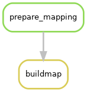
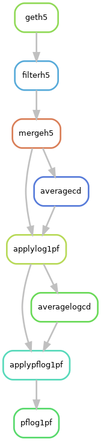
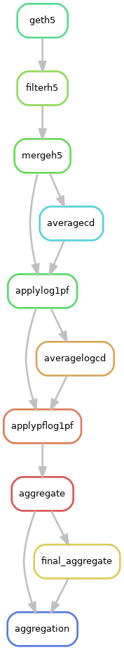

## Quickrun

```bash
#activate an environment with snakemake 7.x (--cluster and --cluster-config are not available in snakemake>=8)
conda activate /path/to/snakemake_env

#generate geno-pheno map - needed just once per freeze ideally - check that elgh_samples and ukbb_samples are correct
snakemake \
    buildmap \
    --cluster-config lsf.yaml \
    --cluster "bsub -q {cluster.queue} -G {cluster.group} -M {cluster.memory} -R {cluster.resources} -eo {cluster.error} -oo {cluster.output} -n {cluster.threads}" \
    -j 1 \
    --rerun-triggers 'mtime'

#run normalization
snakemake \
    pflog1pf \
    --cluster-config lsf.yaml \
    --cluster "bsub -q {cluster.queue} -G {cluster.group} -M {cluster.memory} -R {cluster.resources} -eo {cluster.error} -oo {cluster.output} -n {cluster.threads}" \
    -j 20 \
    --rerun-triggers 'mtime'


#run h5ad size reduction based on labels in 'reduce_to'
snakemake \
    reduction \
    --cluster-config lsf.yaml \
    --cluster "bsub -q {cluster.queue} -G {cluster.group} -M {cluster.memory} -R {cluster.resources} -eo {cluster.error} -oo {cluster.output} -n {cluster.threads}" \
    -j 20 \
    --rerun-triggers 'mtime'

#run size reduction based on a specific label: reduction_X, reduction_raw, reduction_couns, reduction_log1p_cp10k
snakemake \
    reduction_counts \
    --cluster-config lsf.yaml \
    --cluster "bsub -q {cluster.queue} -G {cluster.group} -M {cluster.memory} -R {cluster.resources} -eo {cluster.error} -oo {cluster.output} -n {cluster.threads}" \
    -j 20 \
    --rerun-triggers 'mtime'

#run post-normalization aggregation 
snakemake \
    aggregation \
    --cluster-config lsf.yaml \
    --cluster "bsub -q {cluster.queue} -G {cluster.group} -M {cluster.memory} -R {cluster.resources} -eo {cluster.error} -oo {cluster.output} -n {cluster.threads}" \
    -j 20 \
    --rerun-triggers 'mtime'
```

## The lsf.yaml file

The `lsf.yaml` file contains placeholders that must be replaced before running on an LSF cluster: set `group` (`<lsf_group>`) to the LSF user group jobs are charged to, `<small_queue>` to a short queue for operations involving simple processing of `tsv` files, and `<normal_queue>` to a queue suitable for the other, longer and more memory-intensive, operations. The memory requests have been tested on an entire freeze. Merging by tranche can require up to `42G` in our dataset, so `50G` are requested here. Applying log1pf/pflog1pf requires up to `25G` so  `35G` are requested to be on the safe side. In the merging step, files are read and processed in parallel using `8` threads. If adding more threads, also set the proper number in rule `mergeh5`, seen in `workflow/rules/merge.smk`

## The config/config.yaml file

The `config/config.yaml` file contains instructions that provide users with some flexibility when choosing their normalization strategy.
1. At the time of writing, normalization is done on a freeze folder (`in_folder` key): if this needs to be changed, be sure to specify a folder with the same structure (`<tranche>/Donor_Quantification/<pool>/<pool>.<donor>.h5ad`).
2. Output folder  (`out_folder` key) can be freely changed to a path for which the user has write-permission.
3. Normalization is currently done at `tranche` level (`by` key). Ideally, this can be changed to `pool` and the pipeline should be able to run withouth additional changes (not extensively tested for the time being, so feel free to get in touch if you find this is acting weird).
4. The `keep` key allows to specify a file containing a subset of files to use for normalization. If set to `None`, include all the files found in the `in_folder`. 
5. At the merging step, input files can be populated with informations derived from summaries included in the freeze folder structure: the `add` key allows users to specify for a comma-separated list of columns from those report to include in each input file. If set to `None`, no additional information is added.
6. On the other, some information within h5 files can add some complexity when merging h5 files downstream this pipeline. We included the `include_info` key to allow users to specify a comma-separated list of columns to retain from each h5ad `obs`, excluding some redundant/not useful ones. If `all`, keep everything. Some information (`tranche.id`, `experiment.id` and `Pool_ID.Donor_Id`) won't be removed as they are needed for downstream aggregation. 
7. The `norm` key allows the user to choose which information to use to perform normalization. If set to `None`, this is done considering all the cells together, otherwise normalize by group (for instance, with `azimuth.celltyp.l0` normalize across tranches but at cell-type level).
8. One can easily specify cells to include in the analysis with a 1- or 2-column file provided to the `filter` key. If the file has 2 columns, the second one should contain labels for each of the cells to include derived from an integration effort - a dedicated column is therefore added in the final anndata.
9. Eventually, the pipeline allows to aggregate counts at one or more column levels (the `aggregate` key) preparing for limix-qtl (if `None`, aggregate at donor level and stops).
10. For some pipelines requiring downstream merged anndata files, we found easier merging after some of the unused layer were removed to reduce the merged anndata size. Therefore the `reduce_to` key allows users to remove one or more layers among those that are present in the normalized anndata (`X`, `raw`, `counts`, `log1p_cp10k`). 


## rulegraphs

<p float="left">
  
   
  
</p>
